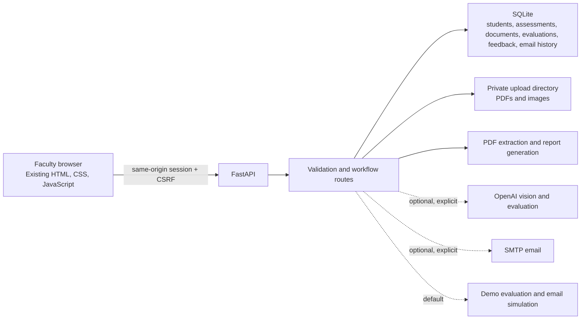

# EvalAI - Faculty Assessment Demo for ABC College

## Project overview

EvalAI is a portfolio demonstration of a faculty workflow for reviewing student answer sheets. The fictional ABC College scenario connects assessment setup, answer extraction, rubric review, approved marks, and individualized feedback in one workspace. Faculty retain control over every official mark and feedback message.

All seeded students, scores, and email addresses are fictional. There is no student login or student-facing dashboard.

## Features

- Existing faculty dashboard and student search/filter workflows backed by FastAPI and SQLite.
- Question and rubric setup; PDF/image upload; file type and size checks; duplicate detection; private file storage.
- Digital PDF text extraction; optional OpenAI vision transcription with uncertainty indicators and faculty corrections.
- Optional structured OpenAI rubric recommendations; approval is required before marks become official.
- Feedback drafts built per student and assessment from approved results, editable and approvable by faculty.
- Individual PDF reports and delivery history. Email simulation is the default; SMTP is used only when explicitly configured.
- Faculty sign-in with signed, eight-hour HttpOnly cookies, CSRF checks, login throttling, and protected data/document APIs.
- Page-size limits, generic provider errors, safe response headers, and disabled public API documentation.
- POSIX upload directories/files use owner-only permissions. On Windows, the upload directory inherits its NTFS ACL; keep the workspace restricted to the faculty/demo operator.

## Architecture



## Technology stack

- Frontend: existing single-file HTML/CSS prototype with small plain JavaScript modules.
- Backend: Python, FastAPI, Pydantic, SQLAlchemy.
- Database: SQLite for a single-instance demonstration.
- Documents: PyMuPDF and Pillow.
- Optional AI: OpenAI Responses API.
- Email: simulation or configured SMTP.
- Tests: pytest, pytest-cov, and FastAPI TestClient.

## Application workflow

1. Faculty signs in and creates an assessment with questions, expected answers, and marking criteria.
2. Faculty uploads reference files and student answer sheets.
3. The backend extracts embedded PDF text. Scanned handwriting stays blank unless vision is explicitly enabled; faculty can inspect and correct extraction.
4. The evaluator proposes question-level marks and rationale. Demo mode uses fixed placeholder marks and does not assess answer quality.
5. Faculty edits, approves, or rejects the proposal. Only approval writes an official result.
6. Faculty prepares, edits, and approves personalized feedback from the approved question results.
7. Faculty downloads a PDF report or records an email attempt. Simulation explicitly states no email was sent. Known successful SMTP sends cannot be repeated through the retry route.

## API overview

Except for health and sign-in/session discovery, `/api/*` routes require faculty sign-in. Mutating requests also require a CSRF token; the browser integration adds it automatically.

| Area | Main routes | Purpose |
| --- | --- | --- |
| Sign-in | `POST /api/auth/login`, `GET /api/auth/session`, `POST /api/auth/logout` | Faculty session |
| Health | `GET /api/health` | Public health check |
| Students/assessments | `GET /api/students`, `GET /api/students/{roll}`, `GET /api/assessments` | Search and performance history |
| Assessment setup | `GET/POST /api/assessment-workspaces` | Questions and marking rubrics |
| Documents | `POST/GET /api/documents`, `POST /api/documents/{id}/process`, `PUT /api/documents/{id}/pages/{page}`, `GET /api/documents/{id}/file` | Upload, extract, verify, view |
| Evaluation | `POST /api/assessments/{code}/students/{roll}/evaluations`, `GET /api/evaluations`, `PUT /api/evaluations/{id}/edits`, `POST /api/evaluations/{id}/approve`, `POST /api/evaluations/{id}/reject` | Proposals and faculty decisions |
| Feedback | `POST /api/evaluations/{id}/feedback`, `GET /api/feedback`, `PUT /api/feedback/{id}`, `POST /api/feedback/{id}/approve`, `GET /api/feedback/{id}/pdf` | Draft, approve, download |
| Delivery | `POST /api/feedback/{id}/deliver`, `GET /api/feedback/{id}/deliveries` | Simulated/SMTP attempt history |

Interactive OpenAPI docs are disabled by default.

## Local setup on Windows

In PowerShell:

```powershell
cd C:\Users\Abhishek\Desktop\evalAi\backend
py -3 -m venv .venv
.\.venv\Scripts\python.exe -m pip install -r requirements.txt
Copy-Item .env.example .env
notepad .env
```

Set private values in `backend\.env`:

- `EVALAI_FACULTY_USERNAME`: your demo account name.
- `EVALAI_FACULTY_PASSWORD`: a private password of at least 12 characters.
- `EVALAI_SESSION_SECRET`: a random value of at least 32 characters. Generate one with `.\.venv\Scripts\python.exe -c "import secrets; print(secrets.token_urlsafe(32))"` and paste it into `.env`.
- Keep `EVALAI_COOKIE_SECURE=false` for local HTTP. Set it to `true` behind HTTPS.
- Keep `EVALAI_EMAIL_PROVIDER=simulation` for the demo.

Start the backend (it serves the existing frontend too):

```powershell
.\.venv\Scripts\python.exe -m uvicorn app.main:app --reload --env-file .env
```

Open `http://127.0.0.1:8000` and sign in with the credentials you configured. Do not use `--host 0.0.0.0` for local work.

## Environment variables

| Variable | Default/requirement | Use |
| --- | --- | --- |
| `EVALAI_FACULTY_USERNAME` | Required | Single configured faculty account |
| `EVALAI_FACULTY_PASSWORD` | Required, 12+ characters | Keep in ignored `.env` or hosting secret manager |
| `EVALAI_SESSION_SECRET` | Required, 32+ random characters | Signs eight-hour sessions |
| `EVALAI_COOKIE_SECURE` | `false` local, `true` HTTPS | Secure cookie flag |
| `EVALAI_DATABASE_URL` | Local SQLite | Point at persistent storage when hosted |
| `EVALAI_UPLOAD_DIR` | `backend/uploads` | Keep outside public/static directories |
| `EVALAI_OCR_PROVIDER` | `demo` | `openai` plus `OPENAI_API_KEY` enables vision |
| `EVALAI_EVALUATION_PROVIDER` | `demo` | `openai` enables model scoring; default marks are placeholders |
| `EVALAI_EVALUATION_MODEL`, `EVALAI_VISION_MODEL` | `gpt-4.1-mini` | Optional OpenAI model choices |
| `OPENAI_API_KEY` | Unset | Secret; answer content may be sent externally when enabled |
| `EVALAI_EMAIL_PROVIDER` | `simulation` | Only `smtp` attempts real email |
| `EVALAI_SMTP_HOST`, `EVALAI_SMTP_PORT`, `EVALAI_SMTP_USERNAME`, `EVALAI_SMTP_PASSWORD`, `EVALAI_EMAIL_FROM` | Unset | SMTP settings; never commit credentials |

Sample addresses end in `.example.test`; they are fictional and cannot receive email. `.env` is ignored by Git and `.env.example` contains no credentials.

## Tests and coverage

```powershell
cd C:\Users\Abhishek\Desktop\evalAi\backend
.\.venv\Scripts\python.exe -m pytest --cov=app --cov-report=term-missing -q
```

Tests use temporary SQLite databases and mocked AI/email providers. They make no paid API calls and send no real email. Optional JavaScript syntax checks:

The current suite passes **26 tests** with **80% overall Python line coverage**.

```powershell
node --check ..\faculty-auth.js
node --check ..\frontend-integration.js
node --check ..\document-workflow.js
node --check ..\evaluation-workflow.js
node --check ..\feedback-workflow.js
```

## Deployment preparation (not deployed)

The Dockerfile and Render Blueprint target a **single-instance** demonstration. The Blueprint mounts `/var/data` for SQLite and files, enables secure cookies, leaves OCR/evaluation in demo mode, and keeps email simulation. A persistent Render disk requires a paid web-service plan; without persistent storage, files and SQLite changes may disappear across restarts/deploys. See [Render persistent disks](https://render.com/docs/disks), [Docker services](https://render.com/docs/docker), and the [Blueprint reference](https://render.com/docs/blueprint-spec).

To deploy later, first place the code in a private Git repository, review the manifest and costs, then create a Render Blueprint and supply the prompted faculty credentials. No deployment has been started. Do not add provider credentials unless intentionally enabling those integrations.

Local Docker commands after creating `backend\.env`:

```powershell
cd C:\Users\Abhishek\Desktop\evalAi
docker build -t evalai-demo .
docker run --rm -p 8000:8000 --env-file backend\.env -v evalai-data:/var/data evalai-demo
```

## Limitations and technical debt

- Seeded people, scores, and contacts are fictional. Demo marks are placeholders, not grading.
- OCR and model evaluation are optional external calls; tests mock those providers. Faculty review is mandatory.
- Feedback generation is rules-based from approved evaluation fields, not an additional model call.
- Simulated email never sends. SMTP `sent` means accepted by the configured server, not confirmed in an inbox; bounce tracking is absent. Failed attempts can be retried, and a known successful send is blocked from repeating.
- There is one shared faculty account, no MFA/SSO, roles, or student portal. Login throttling is in-process and should be supplemented by edge controls before a public service.
- Signed sessions are stateless and last eight hours. Clearing the browser cookie signs out locally; a stolen cookie remains valid until expiry unless the signing secret is rotated.
- SQLite and local file storage are suitable only for a small single-instance demo. No horizontal coordination, automated restore drill, schema migration tool, or production monitoring is included.
- Docker is not installed in this workspace, so the image was not built. The hosting configuration has not been deployed.
- Older prototype-only feedback controls remain simulation-only for compatibility; the connected, faculty-approved workflow is the persisted source of truth.
