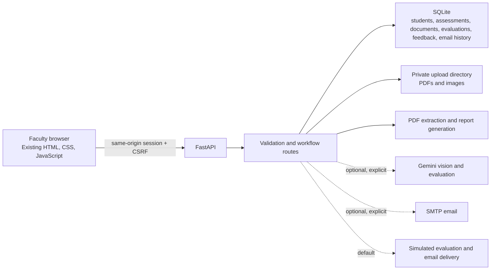

# EvalAI - Faculty Assessment Workspace

## Project overview

The current architecture is direct multimodal grading: matched uploads are queued automatically, original answer-sheet pages are sent to the configured evaluation provider, and question-wise marks plus concise reasons are returned for faculty review and approval. OCR/transcription is not a grading prerequisite. The frontend is organized under `frontend/` and the API under `backend/`. See [docs/architecture.md](docs/architecture.md) for boundaries and limitations.

EvalAI is a local faculty assessment prototype for assessment setup, answer extraction, rubric review, approved marks, and feedback. It uses fictional student records stored in SQLite; no college database is connected. Faculty retain control over every official mark and feedback message.

The current mock dataset contains four fictional Year 2 Information Technology students in Section A, with two Mathematics assessment workspaces and synthetic answer sheets. Engineering supports Year 1 through Year 4, each with Sections A and B. Students do not log in.

## Features

- Existing faculty dashboard and student search/filter workflows backed by FastAPI and SQLite.
- Question and rubric setup; PDF/image upload; file type and size checks; duplicate detection; private file storage.
- Direct multimodal evaluation of original answer-sheet pages; extraction remains an optional diagnostic path, not a grading prerequisite.
- Optional schema-constrained Gemini rubric recommendations; approval is required before marks become official.
- Feedback drafts built per student and assessment from approved results, editable and approvable by faculty.
- Individual PDF reports and delivery history. Email simulation is the default; SMTP is used only when explicitly configured.
- Faculty sign-in with signed, eight-hour HttpOnly cookies, CSRF checks, login throttling, and protected data/document APIs.
- Page-size limits, generic provider errors, safe response headers, and disabled public API documentation.
- POSIX upload directories/files use owner-only permissions. On Windows, the upload directory inherits its NTFS ACL; keep the workspace restricted to the faculty/demo operator.

## Architecture



## Technology stack

- Frontend: existing single-file HTML/CSS prototype with small plain JavaScript modules.
- Backend: Python, FastAPI, Pydantic, SQLAlchemy.
- Database: SQLite for a single-instance deployment.
- Documents: PyMuPDF and Pillow.
- Optional AI: Google's `google-genai` SDK and Gemini Developer API.
- Email: simulation or configured SMTP.
- Tests: pytest, pytest-cov, and FastAPI TestClient.

## Application workflow

1. Faculty signs in and creates an assessment. A question paper PDF is the primary source; supported embedded text is split into editable questions. Manual questions are an alternative when extraction fails or needs correction.
2. Model answers and rubric uploads are optional. Faculty can add typed expected answers per question, add a model-answer PDF later, and choose holistic percentage marking or step-wise criteria. Question maxima determine the assessment total; the correctness threshold and score bands are editable.
3. Faculty uploads student answer sheets. The workspace review API joins submissions directly from stored documents, whether or not a historical score row exists.
4. The backend extracts embedded PDF text. Scanned handwriting stays blank unless vision is explicitly enabled; faculty can inspect and correct extraction.
5. The evaluator proposes question-level marks and rationale. When Gemini is not enabled, fixed simulated marks are used and do not assess answer quality.
6. Faculty edits, approves, or rejects the proposal. Only approval writes an official result.
7. Faculty prepares, edits, and approves personalized feedback from the approved question results.
8. Faculty downloads a PDF report or records an email attempt. Simulation explicitly states no email was sent. Known successful SMTP sends cannot be repeated through the retry route.

## API overview

Except for health and sign-in/session discovery, `/api/*` routes require faculty sign-in. Mutating requests also require a CSRF token; the browser integration adds it automatically.

| Area | Main routes | Purpose |
| --- | --- | --- |
| Sign-in | `POST /api/auth/login`, `GET /api/auth/session`, `POST /api/auth/logout` | Faculty session |
| Health | `GET /api/health` | Public health check |
| Students/assessments | `GET /api/students`, `GET /api/students/{roll}`, `GET /api/assessments` | Search and performance history |
| Assessment setup | `GET/POST /api/assessment-workspaces` | Questions and marking rubrics |
| Documents | `POST/GET /api/documents`, `POST /api/documents/{id}/process`, `PUT /api/documents/{id}/pages/{page}`, `GET /api/documents/{id}/file` | Upload, extract, verify, view |
| Evaluation | `POST /api/assessments/{code}/students/{roll}/evaluations`, `GET /api/evaluations`, `PUT /api/evaluations/{id}/edits`, `POST /api/evaluations/{id}/approve`, `POST /api/evaluations/{id}/reject` | Proposals and faculty decisions |
| Feedback | `POST /api/evaluations/{id}/feedback`, `GET /api/feedback`, `PUT /api/feedback/{id}`, `POST /api/feedback/{id}/approve`, `GET /api/feedback/{id}/pdf` | Draft, approve, download |
| Delivery | `POST /api/feedback/{id}/deliver`, `GET /api/feedback/{id}/deliveries` | Simulated/SMTP attempt history |

Interactive OpenAPI docs are disabled by default.

## Local setup on Windows

In PowerShell:

```powershell
cd C:\Users\Abhishek\Desktop\evalAi\backend
py -3 -m venv .venv
.\.venv\Scripts\python.exe -m pip install -r requirements.txt
Copy-Item .env.example .env
notepad .env
```

Set private values in `backend\.env`:

- `EVALAI_FACULTY_USERNAME`: your faculty account name.
- `EVALAI_FACULTY_PASSWORD`: a private password of at least 12 characters.
- `EVALAI_SESSION_SECRET`: a random value of at least 32 characters. Generate one with `.\.venv\Scripts\python.exe -c "import secrets; print(secrets.token_urlsafe(32))"` and paste it into `.env`.
- Keep `EVALAI_COOKIE_SECURE=false` for local HTTP. Set it to `true` behind HTTPS.
- Keep `EVALAI_EMAIL_PROVIDER=simulation` as configured.

Start the unified local application (the API serves the organized frontend too):

```powershell
.\.venv\Scripts\python.exe -m uvicorn app.main:app --reload --env-file .env
```

In a second PowerShell window, from the same `backend` directory, start the durable processing worker:

```powershell
.\.venv\Scripts\python.exe -m app.worker
```

The API accepts files and records jobs in SQLite. The worker saves page results as it runs, then matches the first-page roll to the selected roster and prepares provisional marks when references and answers are ready. You can close the browser once upload acceptance is shown. Keep the worker running, or restart it to resume saved jobs. Open the assessment from the dashboard for errors, Retry processing, page review, or manual matching. Each provider request has a 25-second SDK timeout and one retry for transient failures. A job runs for at most seven minutes per attempt, with one automatic resume from stored pages.

Open `http://127.0.0.1:8000` and sign in with the credentials you configured. Do not use `--host 0.0.0.0` for local work.

If the browser stays on a loading screen and both `/` and `/api/health` hang, stop the old Uvicorn process and restart it from `backend` with `--env-file .env` as shown above. Faculty credentials and the session secret are checked during application startup; launching without the private environment file can leave a reload parent listening even though its application worker failed to start. Check the startup output for `Application startup complete.` before opening the page.

## Environment variables

| Variable | Default/requirement | Use |
| --- | --- | --- |
| `EVALAI_FACULTY_USERNAME` | Required | Single configured faculty account |
| `EVALAI_FACULTY_PASSWORD` | Required, 12+ characters | Keep in ignored `.env` or hosting secret manager |
| `EVALAI_SESSION_SECRET` | Required, 32+ random characters | Signs eight-hour sessions |
| `EVALAI_COOKIE_SECURE` | `false` local, `true` HTTPS | Secure cookie flag |
| `EVALAI_DATABASE_URL` | Local SQLite | Point at persistent storage when hosted |
| `EVALAI_UPLOAD_DIR` | `backend/uploads` | Keep outside public/static directories |
| `EVALAI_OCR_PROVIDER` | `demo` | Set to `gemini` with `GEMINI_API_KEY` to enable vision transcription |
| `EVALAI_EVALUATION_PROVIDER` | `demo` | Set to `gemini` with `GEMINI_API_KEY` to enable rubric recommendations; default marks are placeholders |
| `EVALAI_EVALUATION_MODEL`, `EVALAI_VISION_MODEL` | `gemini-3.8-flash` | Optional Gemini model choices; must support image input for vision and structured JSON for evaluation |
| `GEMINI_API_KEY` | Unset | Private provider credential |
| `EVALAI_ALLOW_EXTERNAL` | `0` | External processing requires `1` and a file marked fictional in the upload form |
| `EVALAI_EMAIL_PROVIDER` | `simulation` | Only `smtp` attempts real email |
| `EVALAI_SMTP_HOST`, `EVALAI_SMTP_PORT`, `EVALAI_SMTP_USERNAME`, `EVALAI_SMTP_PASSWORD`, `EVALAI_EMAIL_FROM` | Unset | SMTP settings; never commit credentials |

`.env` is ignored by Git and `.env.example` contains no credentials. Gemini keys stay in `backend\.env` or a server-side secret manager and must never be put in frontend code.

For an explicitly authorized Gemini test using fictional files, set the following in `backend\.env` and restart both processes. Select the fictional-files option in assessment setup before uploading:

```dotenv
EVALAI_ALLOW_EXTERNAL=1
EVALAI_OCR_PROVIDER=gemini
EVALAI_EVALUATION_PROVIDER=gemini
GEMINI_API_KEY=<your private key>
EVALAI_VISION_MODEL=gemini-3.8-flash
EVALAI_EVALUATION_MODEL=gemini-3.8-flash
```

Gemini requests can incur charges or be subject to free-tier quotas according to the Google AI Studio project. No provider call is made by the test suite; its provider responses are mocked. Handwritten extraction always remains flagged for faculty verification, and Gemini marks remain provisional until faculty approval.

## Tests and coverage

```powershell
cd C:\Users\Abhishek\Desktop\evalAi\backend
.\.venv\Scripts\python.exe -m pytest --cov=app --cov-report=term-missing -q
```

Tests use temporary SQLite databases and mocked AI/email providers. They make no paid API calls and send no real email. Optional JavaScript syntax checks:

The browser regression runs with Playwright and Edge on Windows. Install Playwright in the backend environment to include it.

To generate practice PDFs for the fictional Year 2 IT, Section A roster:

```powershell
.\.venv\Scripts\python.exe tests\fixtures\pipeline_pdfs.py .integration-test\fictional-pdfs
```

Use demo evaluation for a local-only trial. Create a new Year 2, Section A assessment, attach the question paper and model answer, then submit the four `answer-*.pdf` files with the matching selector on Detect automatically. Filenames contain no roster IDs. `mismatch-example.pdf` is an optional separate test for a detected roll outside the roster.

```powershell
node --check ..\faculty-auth.js
node --check ..\frontend-integration.js
node --check ..\document-workflow.js
node --check ..\evaluation-workflow.js
node --check ..\feedback-workflow.js
```

## Deployment preparation (not deployed)

The Dockerfile and Render Blueprint target a **single-instance** service. The Blueprint mounts `/var/data` for SQLite and files, enables secure cookies, leaves OCR/evaluation in simulated mode, and keeps email simulation. A persistent Render disk requires a paid web-service plan; without persistent storage, files and SQLite changes may disappear across restarts/deploys. See [Render persistent disks](https://render.com/docs/disks), [Docker services](https://render.com/docs/docker), and the [Blueprint reference](https://render.com/docs/blueprint-spec).

To deploy later, first place the code in a private Git repository, review the manifest and costs, then create a Render Blueprint and supply the prompted faculty credentials. No deployment has been started. Do not add provider credentials unless intentionally enabling those integrations.

Local Docker commands after creating `backend\.env`:

```powershell
cd C:\Users\Abhishek\Desktop\evalAi
docker build -t evalai .
docker run --rm -p 8000:8000 --env-file backend\.env -v evalai-data:/var/data evalai
```

## Limitations and technical debt

- Simulated evaluation marks are placeholders and are not answer-quality assessments.
- Question splitting uses text-layer heuristics; scanned paper extraction and handwritten answer recognition were not verified with live Gemini calls. Extraction output must be reviewed.
- Marking mode, correctness threshold, and score bands are sent as policy context to the evaluator. They are editable guidance, not a calibrated or deterministic grading guarantee. OCR/text similarity is not a mathematical-correctness score.
- OCR and model evaluation are optional external calls; tests mock those providers. Faculty review is mandatory.
- Feedback generation is rules-based from approved evaluation fields, not an additional model call.
- Simulated email never sends. SMTP `sent` means accepted by the configured server, not confirmed in an inbox; bounce tracking is absent. Failed attempts can be retried, and a known successful send is blocked from repeating.
- There is one shared faculty account, no MFA/SSO, roles, or student portal. Login throttling is in-process and should be supplemented by edge controls before a public service.
- Signed sessions are stateless and last eight hours. Clearing the browser cookie signs out locally; a stolen cookie remains valid until expiry unless the signing secret is rotated.
- SQLite and local file storage are suitable only for a small single-instance service. No horizontal coordination, automated restore drill, schema migration tool, or production monitoring is included.
- Docker is not installed in this workspace, so the image was not built. The hosting configuration has not been deployed.
- Older prototype-only feedback controls remain simulation-only for compatibility; the connected, faculty-approved workflow is the persisted source of truth.


## Local mock data

The checked local database holds four fictional Year 2 Information Technology students in Semester III, Section A, two Mathematics workspaces, 32 question/model-answer records, and eight supporting document records. All answer sheets are linked to the Section A workspace. The retained Section B workspace remains available with its complete question and model-answer set; it has no students assigned. The app does not connect to a college system. Back up `backend/evalai.sqlite3` and `backend/uploads` before any manual data or schema changes. Assessment classes are `ENGG1` through `ENGG4`, corresponding to Engineering Year 1 through Year 4; each supports Section A and Section B.
